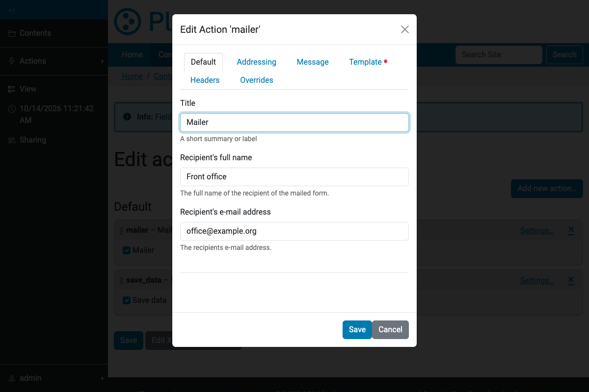
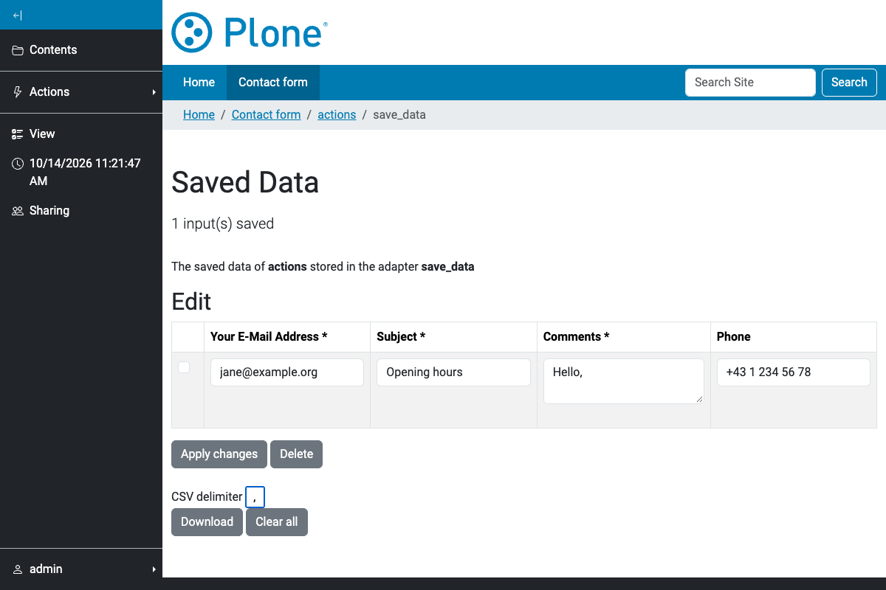

Actions
=======

Actions are what happens with a submission: mail it, store it, run a script
or ask the sender for a confirmation first. They are managed in the *Edit
actions* view: open the *Actions* menu of the toolbar and choose *Define
form actions*, or append ``/@@actions`` to the URL of the form.

.. image:: images/created-easyform-actions.png
   :alt: The Edit actions view with the default Mailer action

A new form has one *Mailer* action. Every action has a checkbox that
enables or disables it - after changing checkboxes click *Save*. Actions
run in the order of the listing; drag the handle to reorder them.

Adding an action
----------------

*Add new action…* asks for a title, a short name and the action type.

.. image:: images/add-new-action-overlay.png
   :alt: The Add new action dialog, adding a Save Data action

.. image:: images/added-new-action.png
   :alt: The Edit actions view with the Mailer and the new Save Data action

Which action types a user may add depends on permissions: *collective.easyform:
Add Mailers*, *Add Data Savers* and *Add Custom Scripts*. Custom scripts are
Python code and by default reserved to Managers.

Mailer
------

The mailer sends the submitted data by e-mail. Its settings dialog
(*Settings…*) is organised in tabs:

* **Default** - title, the recipient's name and e-mail address. Without a
  recipient the mail goes to the form owner's address, falling back to the
  site's e-mail address.
* **Addressing** - extract the recipient, Cc, Bcc or Reply-To from form
  fields, for example to reply to the sender.
* **Message** - subject, optional body text before and after the data, which
  fields are included, and whether the data is attached as CSV, XLSX or XML
  file.
* **Template** - the page template that renders the mail body.
* **Headers** - extra mail headers and request headers to include.
* **Overrides** - TALES expressions for sender, recipient, Cc, Bcc and
  subject.

.. image:: images/mailer-adapter-message-settings.png
   :alt: The Message tab of the mailer settings

The mail body is rendered from a page template. To change it for a whole
site, put a file ``easyform_mail_body_default.pt`` into the site root; start
from ``mail_body_default.pt`` in the ``default_schemata`` directory of this
package.

Save Data
---------

The *Save Data* action stores every submission. Its *Saved Data* view
(``/actions/<name>/@@data``, also linked from the *Actions* menu as *Saved
form input*) lists the entries, lets you edit and delete them, and
downloads everything as CSV, TSV or - with the ``downloadxlsx`` extra
installed - XLSX.

For programmatic access, the ``@@get_save_data_adapters`` view of a form
returns its save data adapters. This page template lists them with the
number of stored rows::

    <ul tal:define="adapters here/get_save_data_adapters">
      <li tal:repeat="adapter adapters">
        ID:
        0 items
      </li>
    </ul>

Custom Script
-------------

A *Custom Script* action runs Python code (a Zope Python Script) with the
parameters ``fields`` (the submitted data as a dictionary), ``easyform``
(the form) and ``request``. To reject the submission, return a dictionary
mapping field names to error messages; the key ``request.FORM_ERROR_MARKER``
sets a form-wide error message.

Double Opt-In
-------------

Anybody can type somebody else's name and e-mail address into a form - a
captcha only proves that a human is present. The *Double Opt-In* action
holds a submission back until the entered e-mail address confirmed it:

1. Add an action of type *Double Opt-In*. Its position in the action list
   does not matter: as long as it is enabled, all other actions of the form
   are held back until the submission is confirmed.
2. Select the *E-mail field*: the form field holding the address that has to
   confirm the submission. Subject and text of the confirmation e-mail, the
   validity of the link (default 48 hours) and the title and text of the page
   shown after submitting can be adjusted. The mail text must contain
   ``${confirm_url}``; ``${expiry_hours}``, ``${form_title}``, ``${email}``
   and ``${<field name>}`` for any form field are available as well.
3. On submission the visitor sees the pending page (``@@doubleoptin-pending``)
   and receives the confirmation e-mail. The link opens
   ``@@doubleoptin-confirm``, where a click on *Confirm* completes the
   submission (deliberately one extra click, so that link scanners of mail
   systems cannot confirm anything). The remaining actions then run with the
   stored data, afterwards the thanks page texts of the form are shown or its
   redirect override is followed.

Unconfirmed submissions are stored as an annotation on the form and removed
after the link expired. A token can be used exactly once. Note for *Custom
Script* actions: on the replay they get the form data via ``fields``, while
``request.form`` only holds the token.

Adding this action requires the *collective.easyform: Add Mailers*
permission, since it sends mail.

Expired submissions are removed whenever the form receives a new
submission. To remove them independently of that - say, nightly - call the
purge view as a Manager: ``<form>/@@doubleoptin-purge`` purges one form,
``<site>/@@doubleoptin-purge`` every form of the site. It answers with a
plain text report, which makes it easy to run from a cron job::

    curl -sf -u cronuser:secret https://www.example.org/@@doubleoptin-purge

Forms whose Double Opt-In action has been disabled or removed lose all
their pending submissions on purge, since nobody could confirm them
anymore.

The XML actions model
---------------------

Like the fields, the actions are stored as an XML model. *Edit XML Actions
Model* opens it in an editor.

.. image:: images/edit-xml-actions-model-page.png
   :alt: The XML actions model editor
