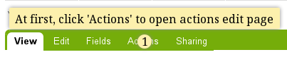
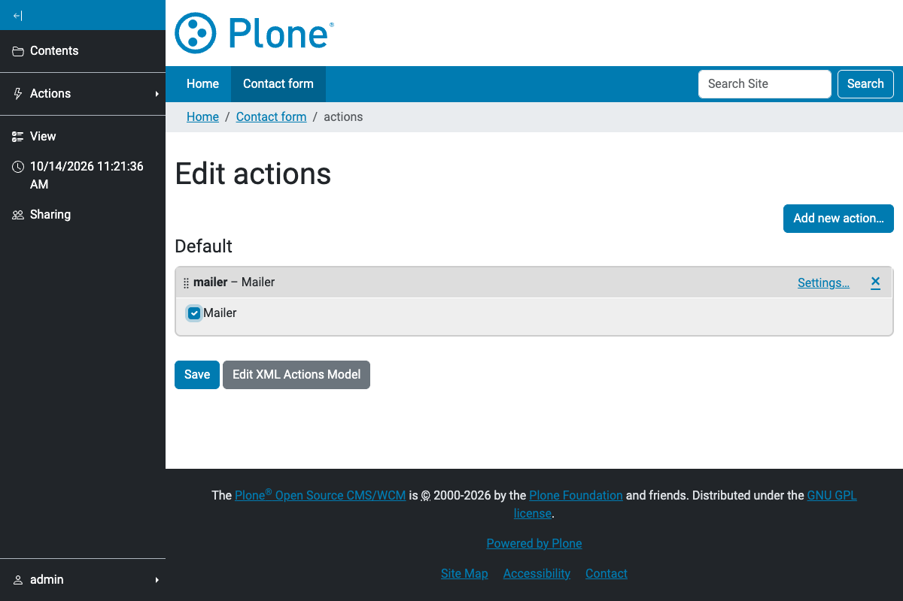
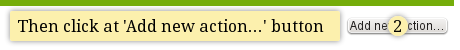
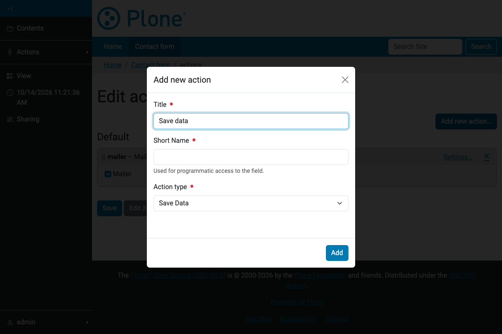
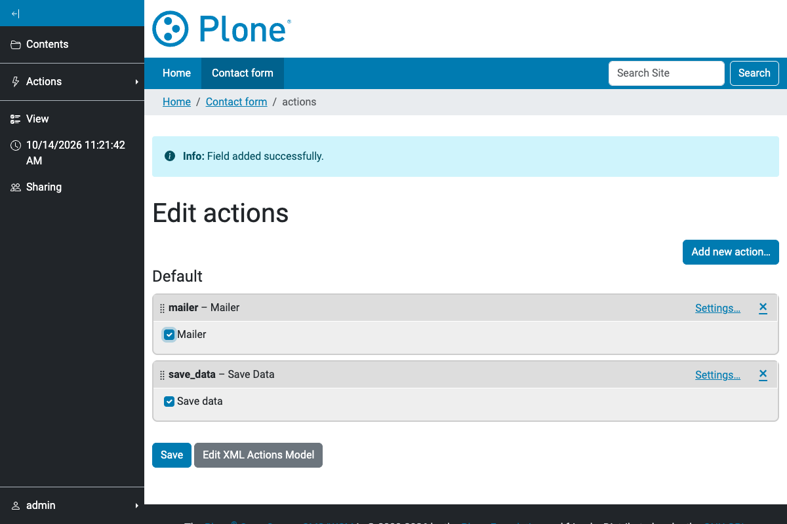
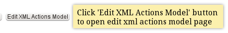
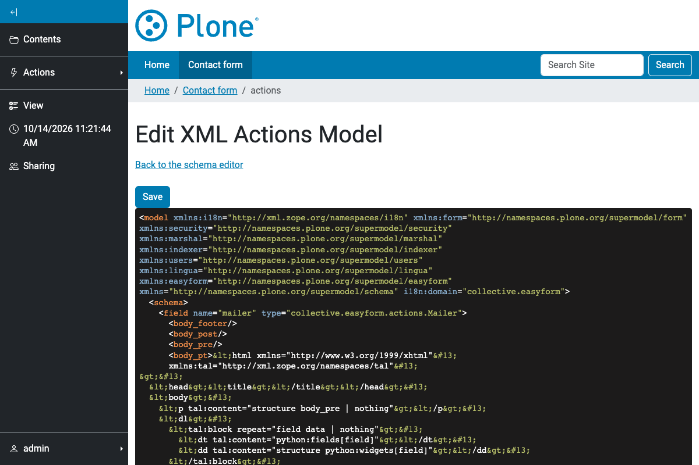
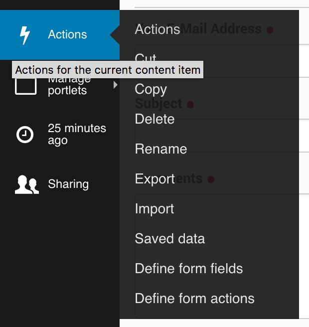
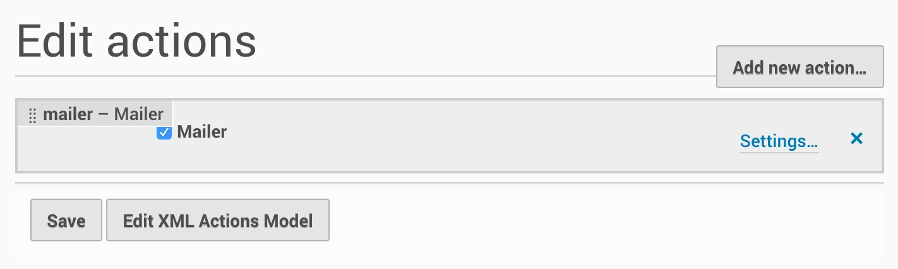
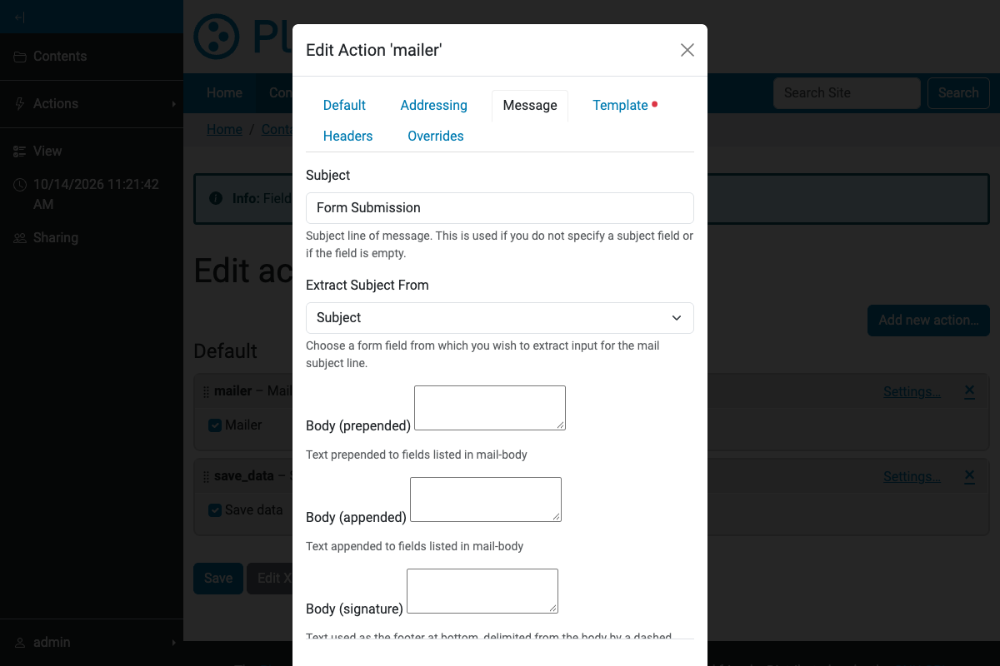

Actions
=======

Adding new action
-----------------

Edit action
-----------

Edit XML Actions Model
----------------------

Save data adapter
-----------------

The Save Data adapter saves data submitted to a form. You can export the saved data as a comma-separated values (CSV)
or a tab-separated values (TSV) file. You can view the saved data and edit it.

If you need programmatic access to the saved data, e.g. to display the number of saved data rows for a given form,
use the `@@get_save_data_adapters` view. The following `count_items` page template displays the number of saved data
rows for all save data adapters for a given form by calling the `@@get_save_data_adapters` view then, for each
save data adapter it returns, outputting its ID and the number of rows it contains.

::

    <html>
      <head>
        <title tal:content="template/title">The title</title>
        <meta http-equiv="content-type" content="text/html;charset=utf-8">
      </head>
      <body>

        The form with ID [form id] contains the following save data adapters:

        <ul>
            

                <li>
                    ID: [item count] items
                </li>

            

        </ul>

      </body>
    </html>

This is what `count_items` outputs:

::

    The form with ID ff1 contains the following save data adapters:
    <ul>
    

    <li>
    save_data: 6 items
    </li>
    

    

    <li>
    save_data_2: 2 items
    </li>
    

    </ul>

Mailer Adapter
--------------

When you create an EasyForm, it includes a mailer adapter action that is activated by default.

You can view an EasyForm's actions by clicking on the Actions toolbar menu, choosing "Define form actions".

You can view and change the settings of that mailer by clicking on its "Settings..." link.

In the mailer's settings, the "Message" tab contains checkboxes that let you send submitted data as a CSV or XML file attachment.

Double Opt-In Adapter
---------------------

Anybody can type somebody else's name and e-mail address into a form -
a captcha only proves that a human is present. The Double Opt-In action
holds a submission back until the entered e-mail address confirmed it:

1. Add an action of type *Double Opt-In*. Its position in the action list
   does not matter: as long as it is enabled, all other actions of the form
   are held back until the submission is confirmed.
2. Select the *E-mail field*: the form field holding the address that has to
   confirm the submission. Subject and text of the confirmation e-mail, the
   validity of the link (default 48 hours) and the title and text of the page
   shown after submitting can be adjusted. The mail text must contain
   ``${confirm_url}``; ``${expiry_hours}``, ``${form_title}``, ``${email}``
   and ``${<field name>}`` for any form field are available as well.
3. On submission the visitor sees the pending page (``@@doubleoptin-pending``)
   and receives the confirmation e-mail. The link opens
   ``@@doubleoptin-confirm``, where a click on *Confirm* completes the
   submission (deliberately one extra click, so that link scanners of mail
   systems cannot confirm anything). The remaining actions then run with the
   stored data, afterwards the thanks page texts of the form are shown or its
   redirect override is followed.

Unconfirmed submissions are stored as an annotation on the form and removed
after the link expired. A token can be used exactly once. Note for *Custom
Script* actions: on the replay they get the form data via ``fields``, while
``request.form`` only holds the token.

Adding this action requires the *collective.easyform: Add Mailers*
permission, since it sends mail.

Expired submissions are removed whenever the form receives a new
submission. To remove them independently of that - say, nightly - call the
purge view as a Manager: ``<form>/@@doubleoptin-purge`` purges one form,
``<site>/@@doubleoptin-purge`` every form of the site. It answers with a
plain text report, which makes it easy to run from a cron job::

    curl -sf -u cronuser:secret https://www.example.org/@@doubleoptin-purge

Forms whose Double Opt-In action has been disabled or removed lose all
their pending submissions on purge, since nobody could confirm them
anymore.
