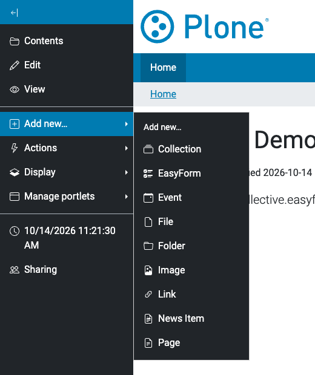
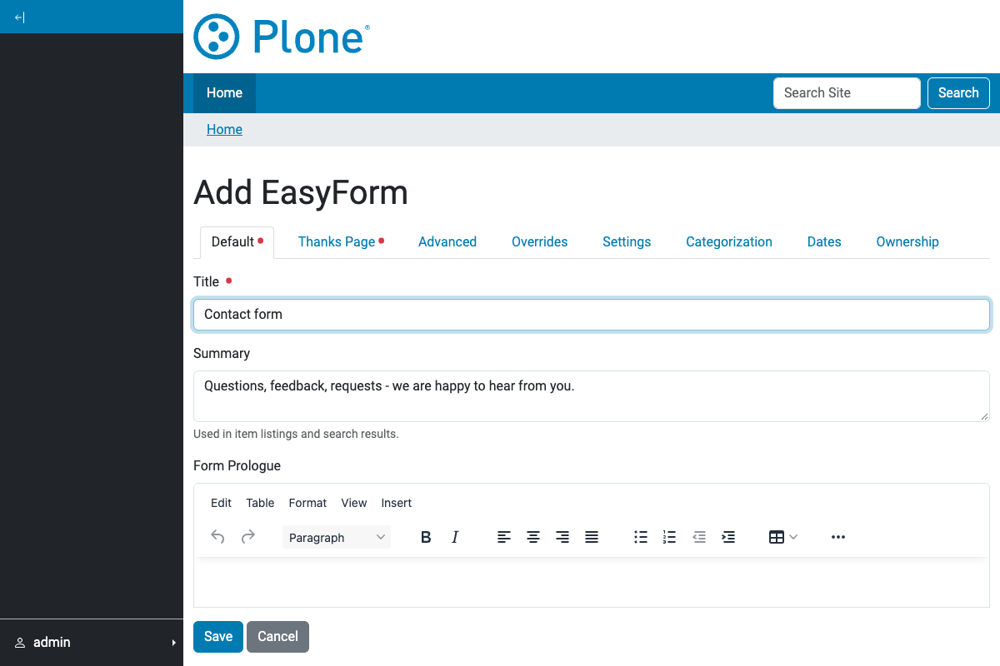
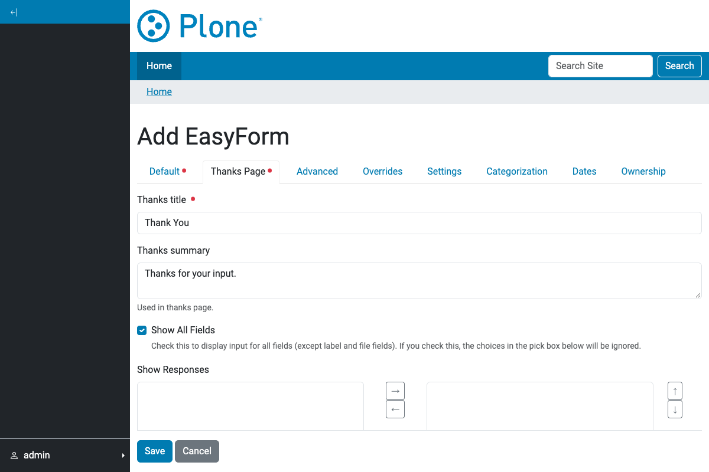
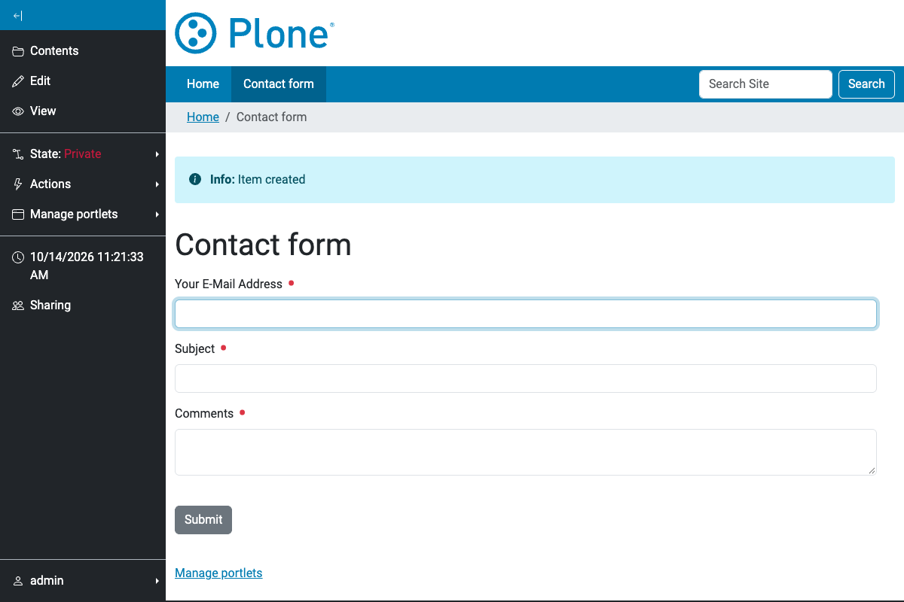
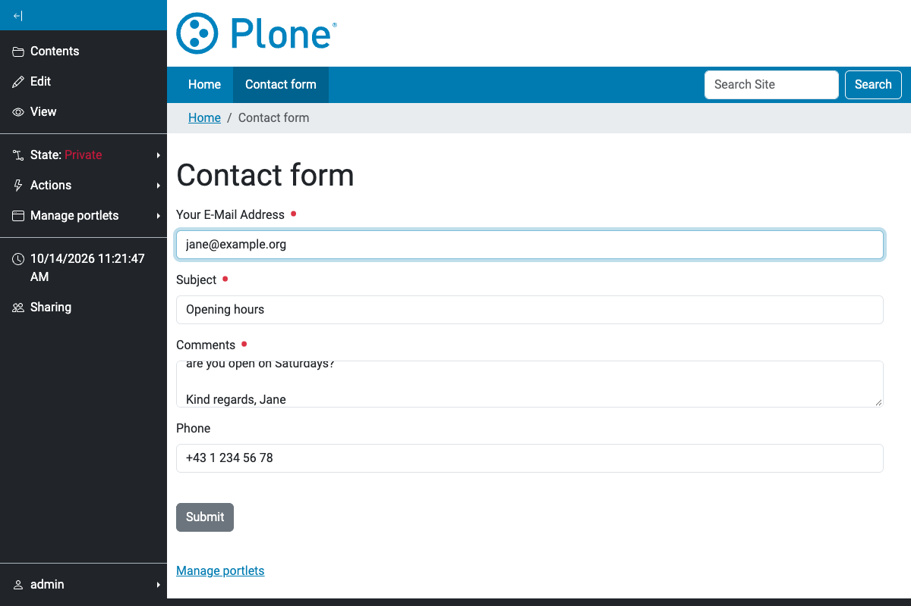
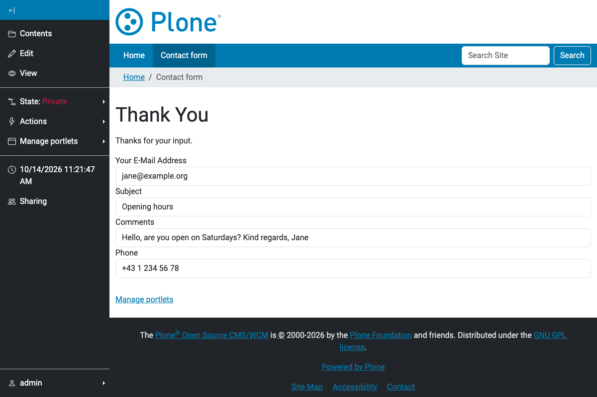

Adding a form
=============

An EasyForm is a content item like a page or a folder. Add it wherever you
may add content: open the *Add new…* menu of the toolbar and choose
*EasyForm*.

The add form
------------

The *Default* tab holds what every form needs: the title, a summary that is
shown in listings, and a prologue and an epilogue - rich text that is
rendered above and below the fields.

The *Thanks Page* tab defines what the visitor sees after submitting the
form: a title, a description, which of the submitted values are displayed
("Show all fields" or a selection) and again a prologue and an epilogue.
Instead of rendering this page you can also redirect to or render another
page of the site, see *Overrides* below.

The *Overrides* tab is for TALES expressions that change how the form
behaves: the form action, the label of the submit button, extra header
markup, or a thanks page override (redirect or traverse to another page
after a successful submission). These fields need the permission
*collective.easyform: Edit TALES Fields*, so editors without it do not see
this tab.

The remaining tabs (*Advanced*, *Settings*) collect options like the submit
and reset button labels, form tabbing, CSRF protection, forcing SSL and
the input method.

After saving, the form is rendered with its default fields and is ready to
be used.

Submitting the form
-------------------

Visitors fill in the form and press *Submit*. Required fields and
validators are checked first; on success the actions of the form run (see
:doc:`actions`) and the thanks page is shown with the submitted values.

Default fields and actions
--------------------------

A new form starts with three fields (*Your E-Mail Address*, *Subject*,
*Comments*) and one *Mailer* action that mails the input to the site's
e-mail address. Both defaults come from the ``default_schemata`` directory
of this package. To change them for a site, put a file
``easyform_default_fields.xml`` or ``easyform_default_actions.xml`` with
your own model into the site root (the XML format is the one shown by the
*Edit XML Fields Model* and *Edit XML Actions Model* buttons, see
:doc:`fields` and :doc:`actions`).
