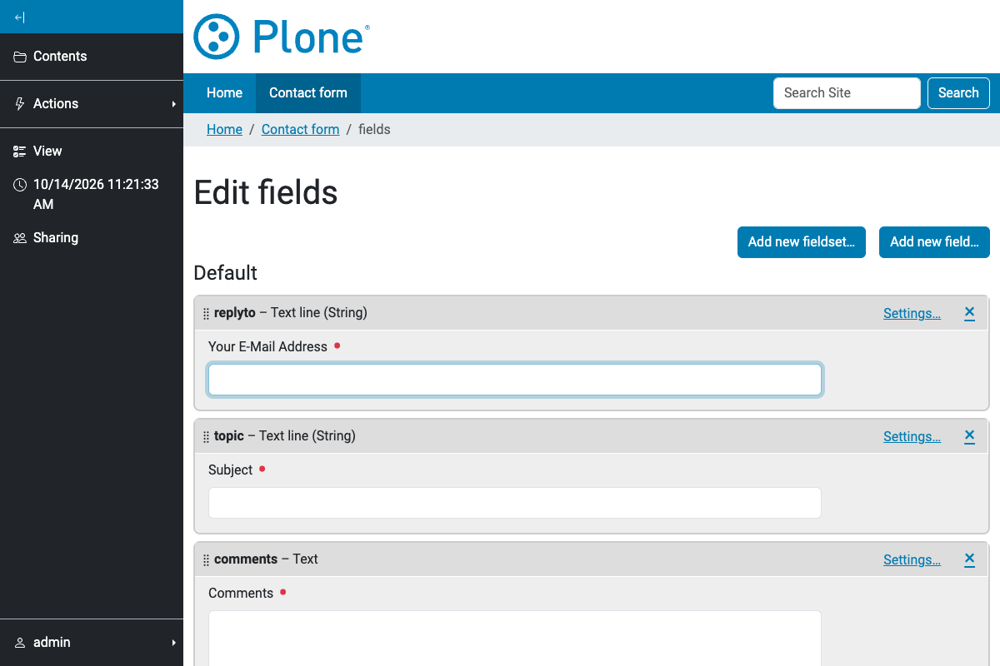
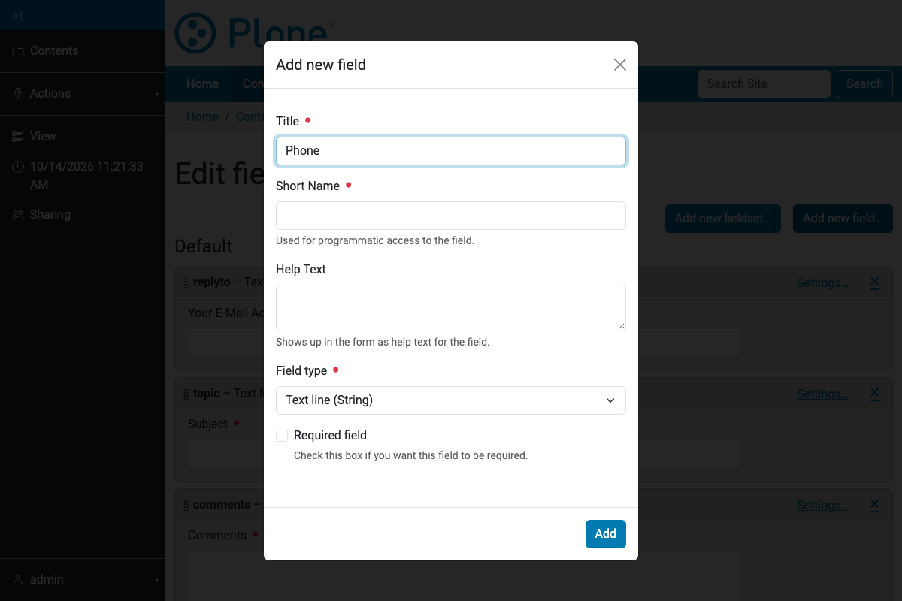
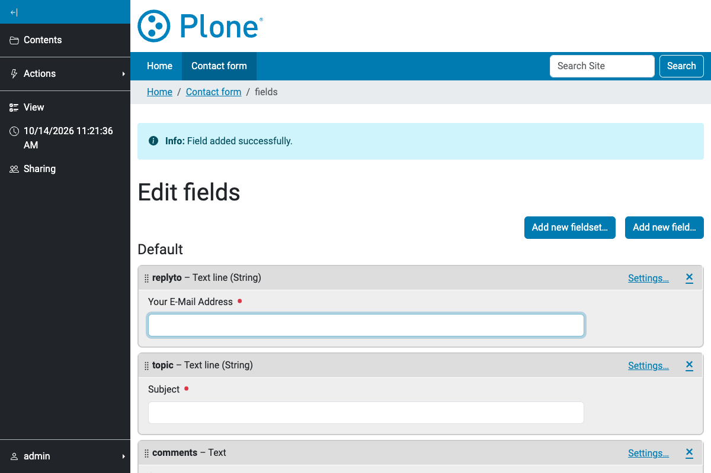
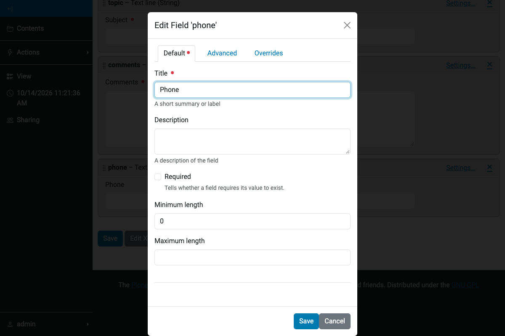
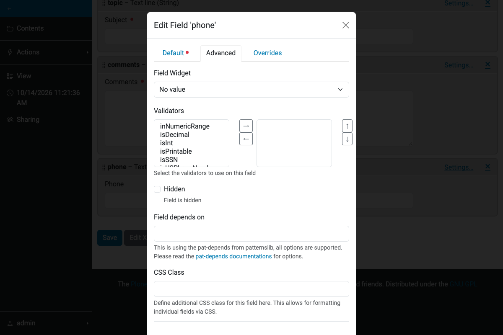
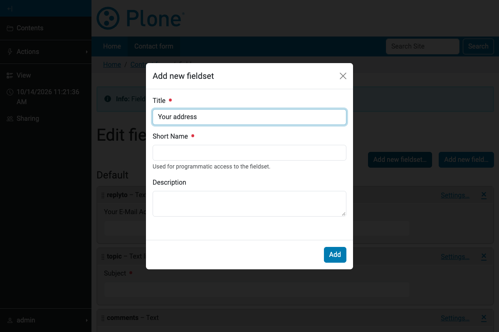
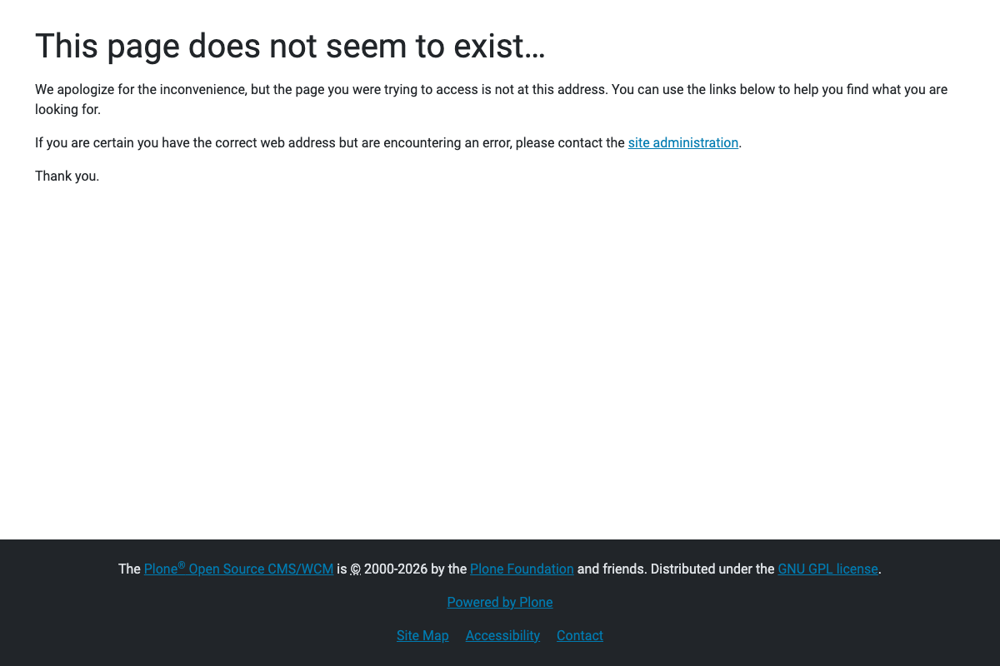

Fields
======

The fields of a form are managed in the *Edit fields* view: open the
*Actions* menu of the toolbar and choose *Define form fields*, or append
``/@@fields`` to the URL of the form.

Every field is shown with its short name and type, a *Settings…* link and a
delete button. Drag the handle on the left to reorder fields; the order is
saved immediately.

Adding a field
--------------

*Add new field…* opens a dialog asking for the title, the short name (filled
in from the title, used in the XML model and in mail templates), a help
text, the field type and whether the field is required.

The new field is appended to the listing:

The field types available in the dialog are configured in the EasyForm
control panel (``/@@easyform-controlpanel``, *Allowed Fields*). Apart from
the usual text, number, date, choice and file fields this is where captcha
fields are switched on, see the README for ReCaptcha, hCaptcha and
norobots.

Field settings
--------------

*Settings…* opens the field's edit dialog. The *Default* tab holds title,
description, the required flag and the default value - what the field type
offers.

The *Advanced* tab adds EasyForm's own options:

* **Field Widget** - an alternative widget for the field type.
* **Validators** - validators from ``Products.validation`` that run on the
  input, for example ``isEmail`` or ``isInt``.
* **Hidden** - the field is rendered as a hidden input.
* **Field depends on** - a condition that shows the field only when another
  field has a certain value. This uses ``pat-depends`` from Patternslib, all
  of its options are supported (see the `pat-depends documentation
  <https://patternslib.com/demos/depends>`_).
* **CSS Class** - extra CSS classes for the field's wrapper, for example to
  build column layouts (see the README).

The *Overrides* tab takes TALES expressions for the default value, for
enabling the field, for server-side fields and for a custom validator; it
needs the *Edit TALES Fields* permission.

Fieldsets
---------

*Add new fieldset…* groups the fields that follow into a fieldset. Depending
on the form's *Form tabbing* setting fieldsets are rendered as tabs or as
plain sections.

The XML fields model
--------------------

The fields of a form are stored as a `plone.supermodel
<https://pypi.org/project/plone.supermodel/>`_ XML schema. *Edit XML Fields
Model* opens it in an editor - handy to copy fields between forms, to
version a form definition or to set options the dialogs do not offer.

Validating file uploads
-----------------------

For file upload fields the package comes with a validation view that checks
the file size and the file type. Use it as *Custom Validator* on the
*Overrides* tab of the field.

File size, in bytes::

    python:portal.restrictedTraverse('validate_file')(value, size=300)

File type, checked against the file extension, as a whitelist::

    python:portal.restrictedTraverse('validate_file')(value, allowed_types=('pdf', 'docx'))

or as a blacklist::

    python:portal.restrictedTraverse('validate_file')(value, forbidden_types=('zip', 'rar'))

The types in ``allowed_types`` and ``forbidden_types`` must be lowercase.
